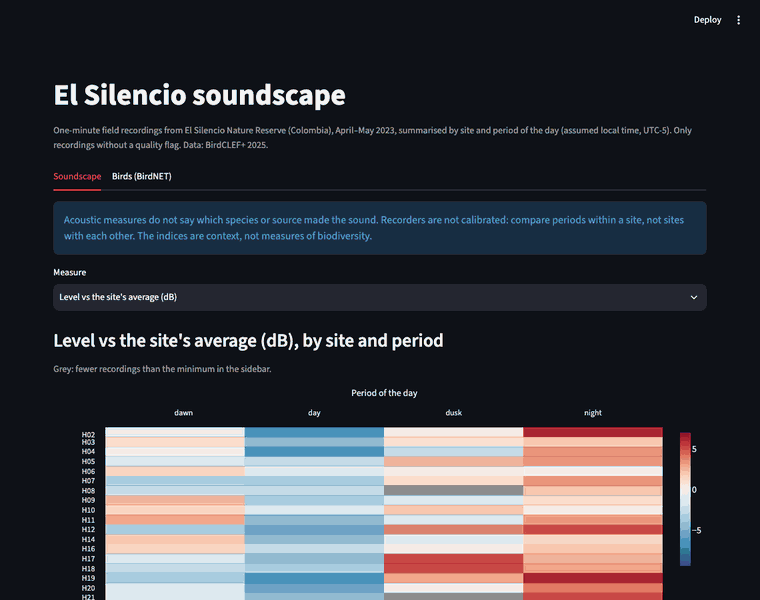
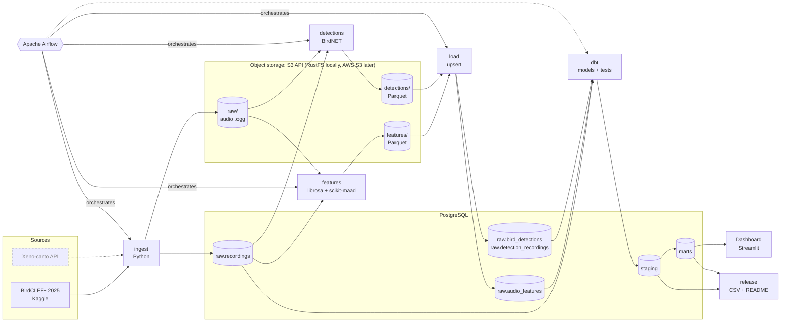
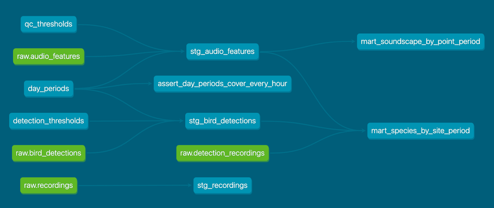

# Soundscape Data Pipeline

[](https://github.com/Dres3223/soundscape-data-pipeline/actions/workflows/ci.yml)

**In short:** an end-to-end data pipeline that turns 9,726 one-minute field
recordings from El Silencio Nature Reserve (Colombia) into acoustic indices,
audio quality flags and automatic bird detections, loaded into tested tables,
shown in a dashboard and published as an open dataset. Python, Airflow, dbt,
PostgreSQL, S3-compatible storage, Docker, Terraform and GitHub Actions. The
full dataset runs in about 2 hours with no failures, and the bird detections
are checked against published labels.



## The problem

Passive acoustic monitoring leaves recorders in a forest for weeks: here, 56
sites over 38 days of April–May 2023, 162 hours of audio. Nobody can listen to
all of it. Ecologists want to know how the soundscape changes through the day
and which birds call where, and they need numbers they can trust and
reproduce.

The data engineering problem is to turn 4.3 GB of raw audio into reliable
tables: every step idempotent and incremental, every number traceable to its
recording, failures visible instead of silent, and the whole thing
reproducible on another machine with one command.

## Results

| | |
|---|---|
| Recordings processed | **9,726** from 56 sites, 0 failures |
| Usable after quality control | **8,890** (91 %); 836 flagged for low-frequency noise, heavy rain or clipping |
| BirdNET scores ≥ 0.1 | **145,617**; 6,666 pass both thresholds, **197 species** |
| BirdNET against published labels | precision **0.80**, recall **0.14** per recording ([validation](docs/validation.md)) |
| Full run (Docker on an M1 Pro) | **~2 h**: features 1 h 55 min with 4 processes, BirdNET 38 min, in parallel |
| Tests | 93 pytest (unit, integration, end to end) + 81 dbt data tests, in CI |
| Open dataset | [data-v1.0.0](https://github.com/Dres3223/soundscape-data-pipeline/releases/tag/data-v1.0.0): two reproducible zips with data dictionary and licences |

The validation changed the story: BirdNET is usually right when it names a
species (8 in 10) but finds only 1 in 7 of the species present. So the
dashboard can say where a species was detected, not where it was absent.

## Architecture



Solid lines and boxes are built; dashed ones are planned.

| Stage | Status | What it does |
|---|---|---|
| Ingest | ✅ Built | Uploads raw audio to S3 and registers its metadata in Postgres (idempotent by SHA-256) |
| Features | ✅ Built | Audio features (librosa), ecoacoustic indices (scikit-maad) and quality measures, in parallel; Parquet partitioned by site and month |
| Detections | ✅ Built | Bird species with BirdNET V2.4 per 3-second segment, checked against published labels ([validation](docs/validation.md)); Parquet |
| Load | ✅ Built | Upserts features and detections from Parquet into Postgres |
| dbt | ✅ Built | Staging views with quality flags and detection thresholds (seeds), 2 marts per site and period of the day, 81 data tests |
| Dashboard | ✅ Built | Streamlit app over the mart: loudness by site and period, one site through the day |
| Airflow | ✅ Built | Runs ingest → features and detections → load daily, with retries; re-running a date duplicates nothing |
| Release | ✅ Built | `make release`: derived datasets as CSV with data dictionary, licence and checksums ([below](#derived-data)) |



## Stack

| Layer | Tool | Why this one |
|---|---|---|
| Orchestration | Apache Airflow 3 (LocalExecutor) | Retries, timeouts and a visible history per task; no extra services |
| Storage | S3 API: RustFS locally ([ADR 0001](docs/adr/0001-s3-compatible-storage.md)), AWS S3 by configuration | Same code locally and in the cloud |
| Intermediate format | Parquet, partitioned by site and month | ~112 files of ~87 rows; by day it would be ~1,680 near-empty files |
| Warehouse | PostgreSQL 18 | Upserts with keys, a read-only role for the dashboard |
| Transformation | dbt (2 marts, 3 seeds, 81 tests) | Thresholds in seeds: change them without re-running the audio stages |
| Audio | librosa, scikit-maad, BirdNET V2.4 | Standard features, ecoacoustic indices and a published bird model |
| Dashboard | Streamlit + Altair | Reads only the marts |
| Infrastructure | Terraform against the Moto AWS emulator | Real IAM permissions, no AWS account or cost |
| Quality | pytest, ruff, pre-commit, GitHub Actions, image on GHCR | Each push runs every test and an end-to-end run on synthetic audio |

## Technical decisions and why

- **Idempotent by content.** A recording's key is the SHA-256 of its file:
  ingesting twice does nothing, features are upserted, and a recording
  analyzed again has its detections replaced, never duplicated. Clearing a
  date in Airflow is always safe.
- **Incremental and resumable.** Features and detections only analyze what is
  new or outdated (a version number per calculation), and write every 250 or
  500 recordings, so a run that stops halfway carries on from there.
- **Thresholds are data, not code.** Quality and detection thresholds live in
  dbt seeds. The BirdNET ones were chosen from the validation curve
  (precision ≥ 0.8), not guessed, and anyone can pick another row and
  rebuild in 10 seconds.
- **Validate before publishing.** BirdNET was compared with published labels
  from 747 annotated minutes; the result, including its low recall, is
  written in the docs and shown in the dashboard.
- **Change the unit of work when an API limits you.** Kaggle allows about 32
  single-file downloads every 30 minutes, which meant days for the full set.
  `scripts/download_all.sh` asks once for the whole archive (12.4 GB) and
  extracts only the soundscapes as it streams in: 15 minutes, without storing
  the archive.
- **Cloud without a cloud account.** Terraform creates the bucket and a
  least-privilege user on the Moto emulator; the same code targets AWS by
  configuration.
- **Reproducible releases.** `make release` gives the same bytes from the same
  database (sorted tables, fixed number formats, zips with fixed dates), with
  one licence per kind of data.

## What I learned

- **Multiprocessing depends on who is `__main__`.** `spawn` re-runs the
  parent's main module in every worker. Inside an Airflow task that is the
  `airflow` command, which cannot start there, so every worker died. Hiding
  `__main__` fixed Airflow and broke `python -m`, where the module itself is
  main; the CI's end-to-end run caught it before it mattered.
- **Read what a library returns, not what you expect.** I assumed BirdNET
  reported the files it could not read by position in my list; they are
  positions in its own sorted, de-duplicated list, so the wrong files would
  have been blamed. A test with a fake result now pins it down.
- **A blank cell is a value too.** In a heat map, groups hidden for having
  few recordings looked like data; they are now grey and labelled.
- **Measure the model before using its numbers.** Without the validation, a
  map of "where each bird lives" would have looked convincing and been mostly
  wrong about absences.

## What these results can and cannot say

- **Acoustic measures do not say what made a sound.** A higher level or
  centroid at some hour may come from animals, rain, wind or the equipment.
  Indices are context, not measures of biodiversity.
- **Bird detections are automatic.** About 1 in 5 is wrong at the chosen
  thresholds, and most birds present are missed: an absence means little.
- **Levels are not calibrated.** Compare them within a site, not between sites.
- **Time and periods are assumptions.** Hours assume local time (UTC-5), and
  the periods of the day are a working choice.
- **Out of scope:** confirming species without an expert; frogs, insects and
  mammals (BirdNET is for birds); changes between seasons or years; population
  trends or effects of restoration.

## Next steps

- Review of the detections by an ornithologist of the region: the change that
  would add the most value.
- Compute everything from the original WAV files of El Silencio Soundscapes
  (Zenodo) instead of Kaggle's compressed OGG copies.
- Run `dbt build` as a task of the Airflow DAG (today it is run separately,
  as in `make run`).
- Deploy to a real AWS account: the Terraform and settings are ready.
- Other taxa (frogs, insects) with models trained for them.

## Quick start

Needs Docker, [uv](https://docs.astral.sh/uv/getting-started/installation/), `make`
and a [Kaggle API token](https://www.kaggle.com/docs/api) with the
[competition rules](https://www.kaggle.com/competitions/birdclef-2025/rules) accepted.

```bash
make setup     # dependencies, git hooks, and .env with random secrets
make data      # metadata and a 16-recording sample (or: bash scripts/download_all.sh)
make up        # Postgres, RustFS, Airflow and the dashboard
make run       # ingest → features → detections → load → dbt build
make release   # export the derived datasets to data/release/
```

Then open the dashboard at http://localhost:8501 and Airflow at
http://localhost:8080. `make` alone lists every command. Every step one at a
time, the AWS emulator and the container image:
[docs/how_to_run.md](docs/how_to_run.md).

## Derived data

`make release` exports what the pipeline computes, never the audio, as two
datasets in `data/release/`, each also as a zip. They are published as
GitHub releases tagged `data-v<version>`
([data-v1.0.0](https://github.com/Dres3223/soundscape-data-pipeline/releases/tag/data-v1.0.0)):

| Folder | Content | Licence |
|---|---|---|
| `indices/` | Recordings, quality flags, acoustic indices, summary per site and period | CC BY 4.0 |
| `detections/` | BirdNET detections, species per site and period, validation tables | CC BY-NC-SA 4.0 |

Each has a README with the data dictionary, method, sources to cite and
limits ([templates](docs/release/)), its licence and `SHA256SUMS`. The
export is reproducible: the same database gives the same bytes, zips
included. How to publish a new version:
[docs/release/PUBLISHING.md](docs/release/PUBLISHING.md). To cite the code,
see [CITATION.cff](CITATION.cff).

## License
The code is released under the [MIT](LICENSE) license.

Data is not covered by that license:

- **Audio:** not in this repository. The pipeline downloads it from Kaggle,
  where BirdCLEF+ 2025 is under [CC BY-NC-SA 4.0](https://creativecommons.org/licenses/by-nc-sa/4.0/).
  The same recordings are published as El Silencio Soundscapes
  ([doi:10.5281/zenodo.17122738](https://doi.org/10.5281/zenodo.17122738))
  under [CC BY 4.0](https://creativecommons.org/licenses/by/4.0/), the basis
  for the derived data's licences.
- **Derived from BirdNET** (its model weights are under CC BY-NC-SA 4.0):
  the tables in `docs/` (`validation_curve.csv`, `validation_species.csv`,
  `detections_coverage.csv`) and the detections release are under
  [CC BY-NC-SA 4.0](https://creativecommons.org/licenses/by-nc-sa/4.0/).
- **Acoustic indices and quality flags** (indices release): [CC BY 4.0](https://creativecommons.org/licenses/by/4.0/).
