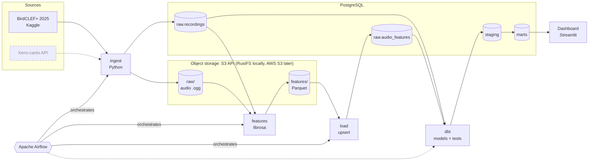
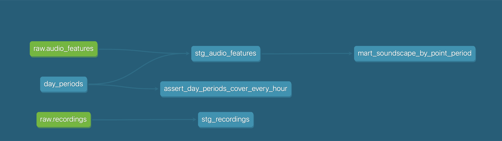
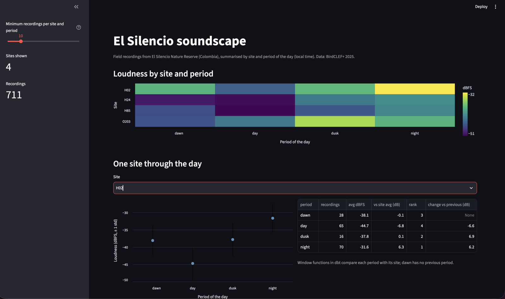

# Soundscape Data Pipeline

[](https://github.com/Dres3223/soundscape-data-pipeline/actions/workflows/ci.yml)

Data pipeline that processes field recordings from El Silencio Nature Reserve (Colombia).

> Work in progress. Data source and decisions: [docs/data_source.md](docs/data_source.md)

## Architecture



Solid lines and boxes are built; dashed ones are planned.

| Stage | Status | What it does |
|---|---|---|
| Ingest | ✅ Built | Uploads raw audio to S3 and registers its metadata in Postgres (idempotent by SHA-256) |
| Features | ✅ Built | Extracts audio features with librosa and writes Parquet partitioned by site and month |
| Load | ✅ Built | Upserts features from Parquet into `raw.audio_features` in Postgres |
| dbt | ✅ Built | Staging views and a mart per site and period of the day, with 40 data tests |
| Dashboard | ✅ Built | Streamlit app over the mart: loudness by site and period, one site through the day |
| Airflow | ✅ Built | Runs ingest → features → load daily, with retries; re-running a date duplicates nothing |

## How to run

### 1. Prerequisites
- [Docker](https://docs.docker.com/get-docker/) with Docker Compose
- [uv](https://docs.astral.sh/uv/getting-started/installation/)
- A Kaggle API token ([how to get one](https://www.kaggle.com/docs/api)) saved in
  `~/.kaggle/access_token`, and the
  [competition rules](https://www.kaggle.com/competitions/birdclef-2025/rules) accepted
- `make` (included in macOS and Linux)

### Quick start
```bash
make setup   # dependencies, git hooks, and .env with random secrets
make data    # dataset metadata and the 16-recording sample from Kaggle
make up      # build and start Postgres, RustFS, Airflow and the dashboard
make run     # ingest → features → load → dbt build
```
Then open the dashboard at http://localhost:8501. `make` alone lists every
command (`make test`, `make lint`, `make down`...). The numbered steps below
are what these commands run, one at a time.

### 2. Install dependencies
```bash
uv sync
uv run pre-commit install   # enable the git hooks (once)
```

### 3. Download the data
```bash
uv run bash scripts/download_metadata.sh
uv run bash scripts/list_files.sh
uv run bash scripts/download_sample.sh   # 16 recordings (~8 MB) for local development
# Optional: every recording of some sites (~178 each), so the marts can
# compare periods of the day within a site
uv run bash scripts/download_sample.sh H02 H24 O203 H85   # ~330 MB
```

### 4. Start the services
```bash
bash scripts/make_env.sh   # .env from .env.example, with random secrets
docker compose build    # build the Airflow image (first time, ~1 min)
docker compose up -d    # start PostgreSQL, RustFS, Airflow and the dashboard
docker compose ps       # every service should be "healthy"
```

| Service | URL | Purpose |
|---|---|---|
| PostgreSQL 18 | `localhost:5432` | Recording metadata and audio features |
| RustFS (S3 API) | `http://localhost:9000` | Raw audio files (S3-compatible object storage) |
| RustFS console | http://localhost:9001/rustfs/console/ | Browse buckets in the browser |
| Airflow 3.3 | http://localhost:8080 | Orchestration UI; user `admin`, password `AIRFLOW_ADMIN_PASSWORD` from `.env` |
| Dashboard | http://localhost:8501 | Soundscape by site and period (after `dbt build`) |

On the first `up`, two one-shot services prepare Airflow and then exit:
`postgres-init` creates Airflow's metadata database and the dashboard's read-only role, and
`airflow-init` migrates it and creates the `admin` user. Airflow reads DAGs
from [`dags/`](dags/); `smoke_check` is a manual DAG that checks tasks can
import the `soundscape` package. Code changes in `src/` apply without
rebuilding; run `docker compose build` again only when dependencies change.

Stop the services with `docker compose down`; data is kept in Docker volumes.
Why RustFS instead of MinIO: [ADR 0001](docs/adr/0001-s3-compatible-storage.md).

### 5. Run the ingestion
```bash
uv run python -m soundscape.ingest   # upload recordings to S3 and register them in Postgres
```
The ingestion is idempotent: re-running it skips recordings already registered
(by SHA-256). Files land in `s3://soundscape/raw/<source>/site=<site>/date=<date>/`
and their metadata in the `raw.recordings` table.

### 6. Extract audio features
```bash
uv run python -m soundscape.features   # write features to S3 as Parquet
```
One row per recording (MFCC, spectral centroid and bandwidth, RMS,
zero-crossing rate), partitioned in `s3://soundscape/features/site=<site>/month=<YYYY-MM>/`.
Recordings that cannot be decoded go to `features_failed/`.
Columns, types and units: [docs/features_schema.md](docs/features_schema.md).

### 7. Load features into Postgres
```bash
uv run python -m soundscape.load   # upsert the Parquet files into raw.audio_features
```
One transaction per run: new recordings are inserted, re-extracted ones
(newer `extracted_at`) are updated, the rest are left unchanged; the log
reports each count. Features of a recording missing from `raw.recordings`
are rejected by a foreign key, and then nothing is loaded.

### 8. Model the data with dbt
```bash
uv run --env-file .env --group dbt dbt deps  --project-dir dbt --profiles-dir dbt
uv run --env-file .env --group dbt dbt build --project-dir dbt --profiles-dir dbt
```
`dbt build` loads the seed, builds the staging views and the mart, and runs
every data test, skipping whatever depends on a failed test. Models, periods
of the day and tests: [dbt/README.md](dbt/README.md).



The dashboard at http://localhost:8501 reads the mart with a read-only role
(`dashboard`, allowed to read `marts` only):



### 9. Or let Airflow run the whole pipeline
Steps 5–7 are what the `soundscape_pipeline` DAG runs every day, in order,
retrying each task twice. In http://localhost:8080 turn the DAG on (or use
*Trigger*), then open a run to see each task's state and logs; the `load`
log reports the inserted, updated and unchanged counts. *Clear* re-runs a
date safely: every stage is idempotent.

### 10. Verify
```bash
docker compose exec postgres psql -U soundscape -d soundscape \
  -c "SELECT site_code, recorded_at, duration_s FROM raw.recordings ORDER BY recorded_at LIMIT 5;"
uv run pytest                        # all tests, with a coverage report
uv run pytest -m "not integration"   # only the fast tests (no services needed)
uv run --group airflow pytest tests/test_dags.py   # DAGs load (installs Airflow)
```

## AWS emulator

The infrastructure is defined for AWS but validated locally against
[Moto](https://github.com/getmoto/moto), an emulator of the AWS APIs: no AWS
account and no cost. This project has not been deployed to a real AWS account.

```bash
make emulator        # start a fresh Moto on localhost:5001 and create its admin user
make infra-apply     # create the bucket, the pipeline's user and its key with Terraform
make infra-check     # confirm that key can do only what it should
make emulator-down   # stop it and erase everything in it
```
Moto keeps everything in memory, so each `make emulator` starts from zero. It
accepts only the 3 requests that create the `terraform-admin` user; after that
every request needs valid keys, so IAM permissions really apply. The admin's
credentials are written to `.env.moto` (git-ignored, owner-only).

Terraform lives in [`infra/terraform`](infra/terraform): the same code targets
the emulator or a real account, chosen with `ENV=moto|aws`. The pipeline's key
is created outside Terraform, so the secret never reaches the state.

## Container image

Every push to `main` that passes CI publishes the pipeline as an image on
GitHub Container Registry, tagged with the commit (`sha-<commit>`) and `latest`.
It holds only the pipeline package and its locked dependencies (multi-stage
build, non-root user): about **1.2 GB on disk, ~280 MB to download**, against
3.9 GB for the Airflow image. Most of it is numba/llvmlite, scipy and pyarrow.

```bash
docker run --env-file .env ghcr.io/dres3223/soundscape-data-pipeline ingest   # or features, load
```
Inside Docker, point the settings at reachable hosts (for example
`-e POSTGRES_HOST=... -e S3_ENDPOINT_URL=...`) and mount the recordings for
`ingest` (`-v ...:/data:ro -e INGEST_SOURCE_DIR=/data/...`).

## License
The code is released under the [MIT](LICENSE) license.

The data is **not** part of this repository nor covered by that license: the BirdCLEF+ 2025 dataset keeps its own [CC BY-NC-SA 4.0](https://creativecommons.org/licenses/by-nc-sa/4.0/) license (non-commercial use, with attribution). The pipeline downloads it directly from Kaggle.
